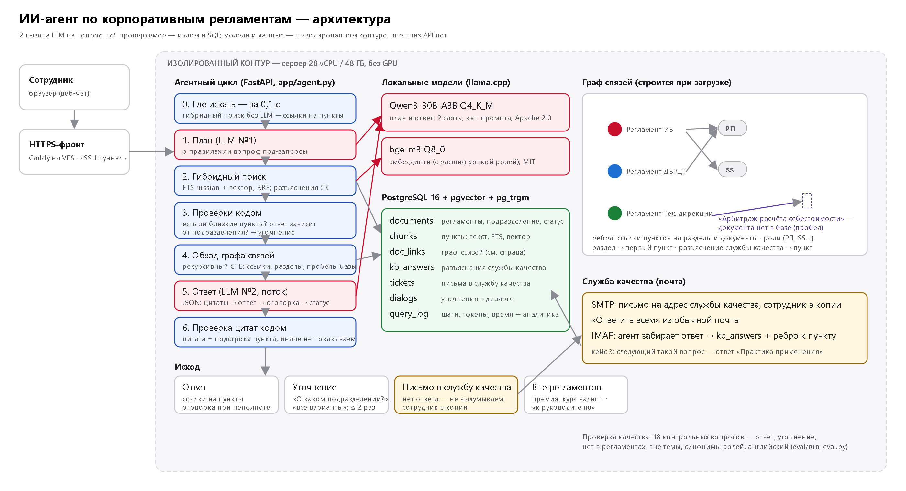

# ИИ-агент поиска ответов по корпоративным регламентам

Хакатон «ИИкузница» (Softline), трек «Аналитик данных», задача «Поиск ответов по корпоративным документам».

Агент отвечает сотрудникам **строго по регламентам**, **уточняет вопрос**, если ответ зависит от подразделения,
а когда ответа в регламентах нет — **не выдумывает**, а пишет в службу качества (сотрудник в копии).
Ответ службы качества агент сам забирает из почты, и следующий такой вопрос получает ответ со ссылкой
на это разъяснение — практика применения регламентов накапливается.

Всё работает **в изолированном контуре**: локальная LLM (Qwen3-30B-A3B, llama.cpp), локальные эмбеддинги (bge-m3),
PostgreSQL + pgvector. Внешних API нет: регламенты и вопросы никуда не уходят.

## Три кейса заказчика

| Кейс | Как реализовано |
|---|---|
| 1. Ответ только по регламенту, иначе — обращение в службу качества | ответ простым языком, каждое утверждение — со ссылкой на пункт и дословной цитатой, которую **проверяет код** (цитата должна быть подстрокой пункта); нет подтверждения или близких пунктов → **письмо на адрес службы качества, сотрудник в копии** (SMTP) |
| 2. Уточняющий диалог | код сравнивает близость вопроса к регламентам каждого подразделения: если ответ есть в нескольких — вопрос «О каком подразделении?» с вариантами и «Не знаю — покажите все варианты» (ответ по каждому подразделению отдельно); модель может уточнить условие; не более 2 уточнений, дальше — ответ или служба качества |
| 3. Дообучение | служба качества отвечает на письмо агента обычным «Ответить всем»; агент забирает ответ из своего ящика (IMAP), добавляет в базу разъяснений (эмбеддинг + ребро графа к пункту регламента) → на похожий вопрос отвечает по нему с пометкой «Практика применения»; частые разъяснения — кандидаты на внесение в регламент |

Также по брифингу заказчика: вопросы не о правилах компании (премия, курс валют) → «обратитесь к руководителю»;
в спорном случае — ответ с оговоркой; сотрудник может «сообщить о несоответствии» регламентов; ссылки на документы,
которых нет в базе, называются в ответе; за доли секунды показывается, **в каком регламенте и пункте** искать
ответ, а текст ответа выводится потоком.

## Архитектура



```
Браузер ─HTTPS─> Caddy (VPS) ─reverse SSH-туннель─> FastAPI (app/) на сервере в контуре
                                                     ├─ llama-server: Qwen3-30B-A3B (чат), bge-m3 (эмбеддинги)
                                                     ├─ PostgreSQL 16 + pgvector + pg_trgm
                                                     └─ почта службы качества (SMTP/IMAP)
```

Агентный цикл (`app/agent.py`): на вопрос — 2 вызова LLM, всё проверяемое — код и SQL.

0. Мгновенно, без LLM: гибридный поиск по исходному вопросу → ссылки «где искать» (0,1–0,2 с).
1. План (LLM № 1): вопрос о правилах компании или нет; 1–3 поисковых под-запроса терминами регламентов.
2. Гибридный поиск: полнотекстовый (морфология russian) + векторный (bge-m3), слияние RRF, только действующие
   редакции; поиск в базе разъяснений службы качества.
3. Проверки кодом: есть ли близкие пункты вообще (иначе — сразу служба качества); зависит ли ответ от подразделения.
4. Обход графа связей (рекурсивный CTE): ссылки пунктов на разделы, подпункты, разъяснения к пунктам,
   ссылки на документы вне базы.
5. Ответ (LLM № 2, JSON-схема, поток): цитаты → ответ → оговорка → статус.
6. Проверка цитат кодом; неподтверждённый ответ не показывается → письмо в службу качества.
7. Журнал: шаги, токены, время, исход → аналитика и калькулятор стоимости.

**Граф связей** (`doc_links`) строится при загрузке документов: ссылки пунктов на разделы, на другие регламенты
и процессы («процесс „Арбитраж расчёта себестоимости“», «регламент подбора субподрядчика»), упоминания ролей
(РП, SS, ГИП…) — общие роли связывают регламенты разных подразделений; разъяснения службы качества связываются
с пунктами. Документы, на которые ссылаются регламенты, но которых нет в базе, видны на вкладке «Документы и граф».

## Интерфейс

- **Чат**: лента шагов агента, ссылки на пункты (открываются в тексте регламента), оговорки, кнопки
  «полезно / неверно / сообщить о несоответствии», e-mail сотрудника для копии писем.
- **Служба качества**: журнал писем, база разъяснений, запасной способ ответить без почты.
- **Документы и граф**: реестр регламентов, граф связей, пробелы базы.
- **Аналитика**: исходы вопросов, время, токены, частые разъяснения (кандидаты в регламент).

## Запуск

```bash
python -m venv venv && venv/bin/pip install -r requirements.txt
createdb corpdocs
# llama-server: Qwen3-30B-A3B-Q4_K_M.gguf на :8080 (--jinja -np 2), bge-m3-Q8_0.gguf на :8081 (--embedding --pooling cls)
DB_DSN=dbname=corpdocs venv/bin/python -m app.ingest data/ --reset     # загрузка DOCX-регламентов + граф
venv/bin/uvicorn app.main:app --host 127.0.0.1 --port 8000
```

Настройки — переменные окружения (`app/config.py`); почта службы качества — `MAIL_USER`, `MAIL_PASS`,
`QUALITY_EMAIL`, `SMTP_HOST`, `IMAP_HOST` (без них письмо только формируется и показывается в интерфейсе).
Служба systemd — `deploy/corpdocs-agent.service`. Пересборка графа без перезагрузки текста: `python -m app.ingest --links`.
Проверка качества: `python eval/run_eval.py --url <стенд>` (контрольные вопросы `eval/questions.json`).
Данные заказчика в репозиторий не входят (`data/`).

## Наработки и сторонние компоненты

Код продукта написан в спринте 26–28.11.2026. До спринта: замер локальных моделей на целевом сервере и подготовка
стенда (llama.cpp как службы, PostgreSQL + pgvector, HTTPS-фронт и туннель). Подходы (гибридный поиск, учёт редакций,
проверка цитат) перенесены из собственного ранее созданного RAG-агента по базе знаний инцидентов СХД, код не переносился.
Идея графа связей с рекурсивным обходом — из подхода Native (withnative.ai). Модели: Qwen3-30B-A3B (Apache 2.0),
bge-m3 (MIT). Компоненты: llama.cpp (MIT), PostgreSQL, pgvector, FastAPI, psycopg, python-docx, httpx и др.
При разработке использовался ИИ-ассистент программирования.
